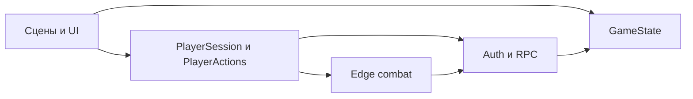

# Архитектура

Клиент 0.39.1. Основная игра и админка — единственные точки входа сборки. Фронтенд собирается Vite и использует Phaser 4.2.1 и DOM. Онлайн-правила работают в Supabase (Auth, PostgreSQL RPC, Edge Functions). Состояние рабочего сервера фиксируется отдельно от SHA клиента в [карточке выпуска](GAME_SYSTEMS/RELEASE_AND_RECOVERY.md).

| Вход | Ответственность |
| --- | --- |
| `/` | Основная игра. `src/main.js` подключает сцены, `src/services.js` связывает состояние, сохранения и игровые действия. |
| `/admin.html` | Админка. Клиент запрашивает операции, сервер проверяет роли и журналирует изменения. |

В локальном режиме `playerModel.js` исполняет JS-правила. В онлайне RPC подтверждают опыт, инвентарь, дары, задания и валюту. `sync_player` принимает только разрешённую часть локального состояния. Для боя сервер фиксирует контекст, Edge повторяет запись действий, SQL сохраняет результат. Системы, исходники и тесты перечислены в [паспортах](GAME_SYSTEMS/README.md).

| Вход генератора | Выход | Проверка |
| --- | --- | --- |
| Правила `src/config/serverRules.js` | `_game_rules()` в `supabase/schema.sql` | `node tools/sql/gen-rules.mjs --check` |
| Боевой движок и `combatVerify.js` | Edge `combat` | `node tools/build-combat-function.mjs --check` |
| Схема и данные восстановления | Историческая recovery-миграция ребаланса | `node tools/sql/gen-recovery-migration.mjs --check` |
| Настройки админки | Серверный каталог админки | `npm run test:admin` |

Художественные и картографические генераторы находятся в `tools/`. Черновики карты и настройки браузера имеют свои ключи хранения. Схема установки и миграции действующей базы обслуживаются по [инструкции выпуска](GAME_SYSTEMS/RELEASE_AND_RECOVERY.md).
