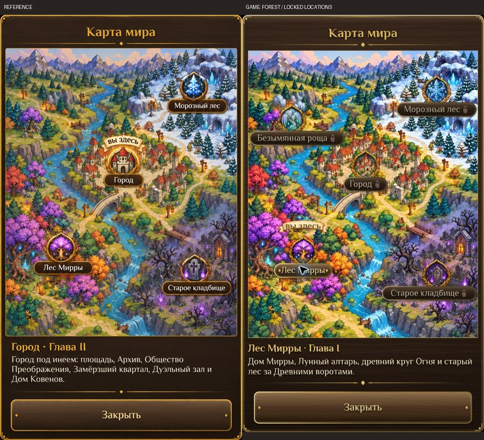
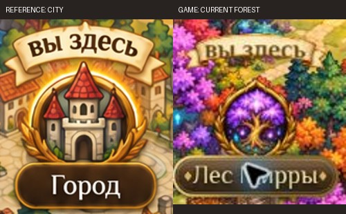

# Painted world map — implementation review (22 October 2026)

Scope: adapt the supplied map artwork to the existing playable world-map modal. All five existing destinations, chapter locks, interior-parent resolution and exit-only travel remain functional.

## Visual evidence and normalization

- Source visual truth: `docs/design/world-map/reference.webp`, converted from the supplied 1024 × 1536 PNG. Original attachment: `/workspace/scratch/7accfa56fae9/upload/Фэнтезийная карта мира с городом и локациями(1).png`.
- Browser-rendered implementation: `docs/design/world-map/game-view.webp` (527 × 936), cropped from `/workspace/scratch/7accfa56fae9/world-map-final.jpg` (1363 × 936).
- Cloud Browser viewport: 1363 × 936 CSS pixels, DPR 1. Phaser logical canvas: 720 × 1280, displayed at x418, y0, 526.5 × 936 CSS pixels. No simulated device chrome.
- Full-view comparison: `docs/design/world-map/comparison.jpg`. Source modal crop (114,23)–(950,1490) normalized to 487 pixels wide; implementation modal crop (438,41)–(925,880), also 487 pixels wide. Both shown together, without stretching their proportions.
- Focused comparison: `docs/design/world-map/marker-detail.jpg`, the reference city badge/ribbon and the implemented current-forest badge/ribbon. Different subjects reflect actual player location; both show the same dynamic marker anatomy.
- State difference: the reference shows chapter II, city current and destinations open. The browser evidence uses a new offline player in the forest, with chapter locks visible. The additional NW grove is an existing chapter III destination, deliberately retained. These are intentional game-state differences, not missing content.

## Comparison history

1. First combined comparison: `/workspace/scratch/7accfa56fae9/world-map-shots/comparison-first.jpg`. [P2] The current-place ribbon sat below the nameplate; the reference puts it above the medallion. [P2] The terrain had wider margins and occupied less of the modal than the source. Result: blocked.
2. Moved the real parchment ribbon above the badge; increased the painted area from 608 to 632 logical pixels wide, reduced map-specific footer spacing, and restored the existing gold divider and a thin map frame. Captured the revised browser implementation and compared the full modal and marker regions together with the source again. The larger terrain now follows the reference proportions; the current marker sits above the correct location. No actionable P0/P1/P2 differences remain.

## Required fidelity surfaces

- Fonts/typography: existing Philosopher serif matches the fantasy UI direction. Title hierarchy, gold subheading and cream body copy remain readable. Labels use the existing native button typography; long descriptions wrap and scroll. Exact source lettering is not a supplied font asset, so the established game font is retained intentionally.
- Spacing/layout rhythm: 4:5 terrain, narrow modal insets, title/divider, destination medallions and bottom close action follow the reference. The footer stays reachable while long descriptions scroll. Icon and label share a larger touch target. A short current-location description can make the overall modal shorter than the city reference.
- Colors/tokens: dark wood and warm gold use existing UI tokens. Saturated forest, snowy blue north and violet cemetery follow the source. Locked destinations have a muted tint and a real lock icon, selected labels have the established gold highlight.
- Image quality: terrain, five medallions and parchment ribbon are ImageGen raster assets guided by the supplied reference. Terrain is 1024 × 1280; badges are 512 × 512 RGBA WebP, ribbon 512 × 160 RGBA. No labels, buttons or location state are baked into the terrain. Alpha edges and final in-game scaling inspected. Natural repainting changes small building/branch details and badge ornament shapes; accepted P3 variation.
- Copy/content: Russian location names, chapter labels and descriptions come from existing location data. «вы здесь» uses the actual player location, independently of selection. The grove, lock reasons and travel instructions are deliberate additions required by the existing game.

## Interactions and verification

- Cloud Browser: open map from the real game menu, select the city by medallion, select cemetery by nameplate, return to forest, inspect locked descriptions, scroll the long cemetery description and close/reopen the modal.
- Console: checked application errors after reload with final code; none. The first development load exposed a transient undefined-radius edit, fixed before the final capture. Browser extension metadata errors are unrelated to the app.
- `npm test`: passed (including map selection, closed destinations, menu-only viewing, exit-only travel, world data and UI smoke checks).
- UI smoke re-run after final layout changes: passed. Existing map test now locates the target that contains the label instead of assuming the old tiny zone center.
- `npm run build`: passed after final code changes. Existing large-chunk warning remains.
- Combat bundle freshness and `git diff --check`: passed.
- Integrated the concurrent journal update from main (`3fd4e6b`), retaining top tabs/full-height journal behavior and map-specific spacing. Re-ran core state tests, UI smoke (including journal) and the production build after resolving the shared modal code; all passed.
- Test gap: this pass renders one Cloud Browser viewport and its portrait Phaser surface; no physical mobile device session or online-account travel was run. Existing state/UI tests cover travel permission and emitted destination.

## Findings / checklist

- [x] Replace old prototype terrain and point circles with illustrated terrain and medallions.
- [x] Keep labels, current-place ribbon, locks and selection live.
- [x] Match map proportions and move ribbon above the current badge.
- [x] Preserve the fifth destination and all travel rules.
- [x] Compare actual browser output against the source at full and focused scales.
- [x] Run game tests and production build.
- P3 follow-up only: exact micro-detail of repainted terrain and badge ornament differs from the single raster reference.

final result: passed

---

# Previous review retained for history

# Archive courtyard — concept 2 implementation review

Scope: a playable trial of the selected courtyard art direction around the Archive, garden and canal. This is an adaptation to the existing game map, not a pixel-for-pixel replacement illustration. The agreed constraints retain the current house sizes/positions, rooms, quest points and original hero scale.

## Visual evidence

- Source: `docs/design/archive-courtyard/selected-concept.webp`, the second displayed image selected by the user on 17 October 2026 (941 × 1670).
- Implementation: `docs/design/archive-courtyard/game-view.webp`, actual Phaser scene captured in the Cloud Browser.
- Full comparison: `docs/design/archive-courtyard/comparison.jpg`.
- Focused comparison of reading furniture, path edge and planting: `docs/design/archive-courtyard/reading-corner-comparison.jpg`.
- Browser viewport: 1363 × 936 CSS pixels, DPR 1; portrait canvas bounds x418, y0, 526.5 × 936. Screenshot crop is 527 × 936. The reference was downsampled to 527 × 936 for side-by-side review. No game artwork was painted into the screenshot.
- Additional constrained game surface: 390 × 844 CSS pixels in the same browser. This verifies surface scaling, not a separate mobile-browser/device run.
- Scene: chapter II started, north bridge locked, player in the courtyard, UI hidden for the art comparison. Existing buildings south of this trial are visible and remain unchanged.

## Comparison history

1. First rendered pass: the new courtyard formed too broad a rounded pad, the table was too far west, and the first garden pass remained sparse. Narrowed the forecourt, made the entry path vertical, moved the table beside the reading bench, enlarged the paving scale, added connected planted borders and additional chapter I tree groups. Re-rendered the scene.
2. Alpha QA found colored edge artifacts in the garden decal after WebP encoding. Restored a lossless exact RGBA export and inspected the decoded image; final alpha edge is clean.
3. Final comparison opened the source and actual implementation together in both full-view and focused comparison images. The courtyard, reading table/books/stools, bench, layered autumn planting, purple Archive facade, earth-edged warm paving and unobstructed route to the canal are present as separate game objects.

## Required fidelity surfaces

| Surface | Result |
| --- | --- |
| Fonts / typography | Existing Philosopher world labels and game HUD are preserved. The concept has no HUD; hiding it in the comparison is intentional. Labels are functional product content, not painted substitutions. |
| Spacing / layout | House and quest coordinates remain unchanged. The irregular forecourt and smaller reading pocket connect to the existing street. Source illustration distances and foreground forest are adapted to existing geometry; neighboring Duel/Coven buildings remain visible. No claim of a pixel-identical scene. |
| Colors | Worn tan sandstone, moss/soil, teal conifers, autumn plum/amber leaves and warm lamps carry the selected direction. The city's unchanged neighboring lawn/paving remains outside the trial. |
| Image quality | Real generated RGBA table and garden ground, generated paving, existing original facade and chapter I tree paintings. No CSS/SVG stand-ins or flattened illustrated map. Table remains legible in the game camera; alpha edges checked. |
| Copy / content | Russian labels and interactions remain intact. No new player-facing technical copy. |

## Interaction and regression evidence

Cloud Browser UI checks:
- Intended local game page/title loaded; canvas shows the real playable map, no framework overlay or missing-texture blocks.
- Preview controls exercised the district view, Archive approach, reading area and constrained 390 × 844 surface.
- Enter Archive: visible state changed to `Городской Архив`, player x12250 y1520, with the existing room rendered.
- Exit Archive: visible state returned to `Город`, player x6850 y2820, the original outdoor doorstep.
- Tap-to-move path started and visibly moved the hero. The complete bridge walk was not timed through in this browser; endpoint reachability and closed gate behavior are covered by the map tests below.
- No current app errors in the final run; logged `chrome-extension://...` browser-metadata errors are outside the application. An earlier preview-only nested asset-path failure was fixed with the preview HTML base path before final capture.

Automated checks:
- `npm test`: passed.
- After final planting: `node tests/city-layout-test.mjs`, `node tests/world-test.js`: passed. All city doors, quest targets and the new reading spot reachable; bridge/flooded passage remain locked; save migration/room return geometry preserved.
- `node tests/editor-data-test.mjs`: passed; landmark IDs, catalog and edit export/import preserved.
- `npm run build`, `node tools/check-bundle.mjs`, `git diff --check`: passed.
- The existing browser graphics expectation was updated to allow chapter I trees in the new garden; its full automated browser suite was not rerun.

## Follow-up polish / limits

- The rest of the city intentionally retains its previous art; extending this treatment is a separate visual decision after the user reviews the trial.
- Real-device performance, touch behavior and a full chapter walkthrough were not assessed in this run.
- P3: more low planting variants can reduce repeated bush silhouettes if this direction is approved for the whole city.

No remaining actionable P0/P1/P2 findings within the scoped trial and its stated geometry constraints.

final result: passed
