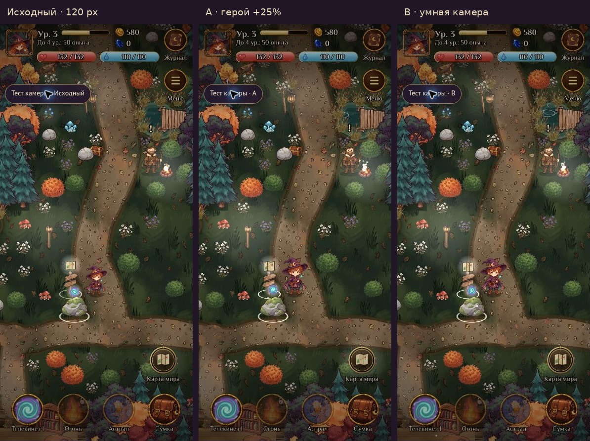

# Тест камеры и управления — 29.10.2026

## Что изменилось

Отдельная HTML-точка входа `camera-test/index.html` включена в Vite multi-page build. Эксперимент переиспользует игровые сцены, графику, аниматор, A*, объекты и HUD текущего `main` (`8e6a59a`, Phaser 3.90 / Vite 6, версия игры 0.39.1).

| Профиль | Изображение героя | Камера |
|---|---|---|
| Исходный | 120 px | Прежнее следование |
| A | 150 px (+25%) | Прежний охват мира |
| B | 150 px (+25%) | Опережение до 9% видимой ширины/высоты; сглаживание 0,4 с |

Физическое тело 34×22, скорость 230, точка опоры у ног, сортировка по Y и исходные настройки zoom сохранены. Для маленьких рисованных комнат применяется прежний cover zoom. Камера ограничена исходными границами сцены. Сюжетные панорамы и CombatScene не изменены.

В B для первого сравнения рекомендовано пройти одну дорогу туда и обратно, включая короткие повороты. A служит проверкой, достаточно ли одного увеличения персонажа. B при остановке возвращается к тому же виду, поэтому неподвижные снимки A/B почти одинаковы: отличие нужно оценивать в движении.

## Изоляция

`initServices()` по умолчанию сохраняет прежнее поведение. Тестовый Boot передаёт `localOnly: true` и storage-адаптер с префиксом `witch_camera_test_v1:`. Он не создаёт PlayerSession, ChatService, Presence или telemetry, даже если production-сборка содержит настройки Supabase. Авторизационные токены не читаются. Тем же адаптером изолированы настройки и предпочтение спутника; исходные ключи сохранения не переименовываются и не мигрируют.

В экспериментальном UI отключены аккаунт, кошелёк, чат, Ковены и сетевые дуэли. Игровые действия выполняются существующим локальным режимом PlayerActions. Редактор не включается параметром `?edit` в эксперименте.

## Управление

Сохраняются существующие WORLD_TAP → onTap → A* → walkTo и виртуальный джойстик. В эксперименте отсутствие маршрута больше не приводит к движению напрямую через препятствия. Второй палец не перехватывает текущий джойстик; отпускание свайпа не создаёт дополнительный тап. Открытие панели сравнения отменяет маршрут и блокирует движение; диалог тоже останавливает героя. Ручного панорамирования мира нет.

## Как проверить

После публикации открыть `/povelitel-tayn/camera-test/` на телефоне. В сворачиваемой панели «Тест камеры» выбрать Исходный, A или B. Пройти одну дорогу тапами и джойстиком, затем проверить кнопки «Город» (площадь у фонтана), «Интерьер» (банк) и смену героя. Ссылка «Основная версия» ведёт на обычную игру.

Для локального запуска: `npm ci`, `npm run dev`, открыть выданный Vite адрес с путём `/camera-test/`. Полная сборка: `npm run build`; `dist/camera-test/index.html` должен существовать. Для проверки опубликованного относительного пути можно использовать `npm run preview` и тот же маршрут.

## Проверки

- `npm ci`: успешно.
- `npm run build`: успешно; создаётся вложенный HTML, графика не дублируется. Предупреждение Vite о большом общем Phaser/game chunk сохраняется.
- `npm test`: полный существующий набор прошёл.
- `node tests/nav-test.mjs`: прошёл.
- `npm run test:camera`: прошёл; проверены namespace сохранений/настроек/спутника, ограничение и сглаживание опережения, возврат после остановки.
- Облачный браузер: проверены 360×800, 390×844, 412×915, 320×568, 720×1280. Изображение героя увеличивается на 25%, коллизии и zoom совпадают, viewport сохраняет пропорции.
- Локальные `tests/e2e/viewport.mjs`, `mobile-ui.mjs` и новый `camera-test.mjs` не стартовали: в контейнере отсутствует Chromium Playwright. Для нового теста и viewport создан GitHub Actions workflow с установкой Chromium.
- `tests/e2e/mobile-ui.mjs` дополнительно содержит старое ожидание заголовка `v0.9.x`, хотя актуальный заголовок — «Колдовство: Магическая RPG»; этот старый тест требует отдельной актуализации. Код основной игры ради этого не менялся.

Cloud Chrome в этой среде ограничивал игровой цикл примерно до 1 FPS; это не замер производительности телефона. Подтверждение 60 FPS на реальном Android/iPhone остаётся отдельной пользовательской проверкой. Аппаратные safe-area, системные жесты и мобильная клавиатура также не воспроизводятся обычным iframe.

## Файлы

Новый runtime находится в `src/camera-test/`, исходная точка входа `src/main.js` и настройки `src/config/game.config.js` не изменены. Общие изменения ограничены опциональными параметрами initServices, инъекцией storage для спутника и дополнительным Vite input. Автотесты и браузерный стенд находятся в `tests/camera-test.mjs`, `tests/e2e/camera-test.mjs`, `tests/browser/`.

Браузерный стенд успешно прошёл полный прогон готовой сборки: все пять размеров, отмена маршрута, мультитач, смена героя, лес/город/банк, отсутствие пропавших текстур, сохранность production storage и отсутствие API-запросов. Существующий CI `Game and chat checks` также прошёл npm test, chat, admin, build и проверку production bundle. Новый нативный touch e2e прогоняется отдельно в CI.

[Город](camera-test/city.jpg) · [Интерьер банка](camera-test/room.jpg)

Результаты CI и публикации дополняются после завершения проверок. Экспериментальные настройки не включаются в основной режим.
