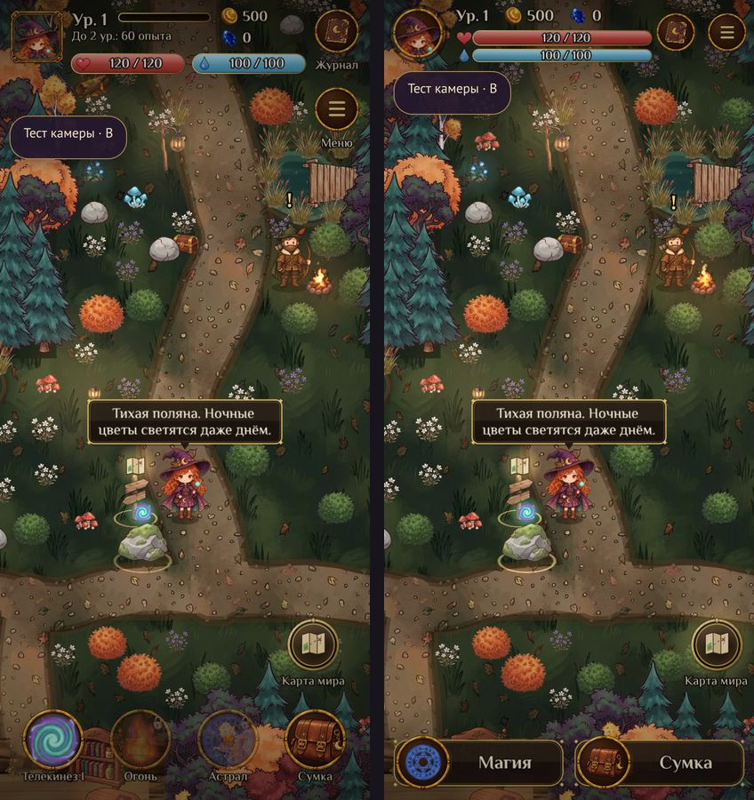
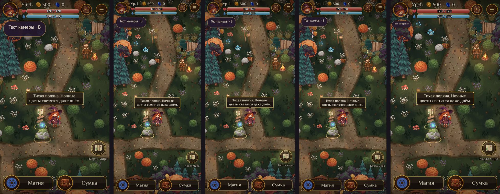
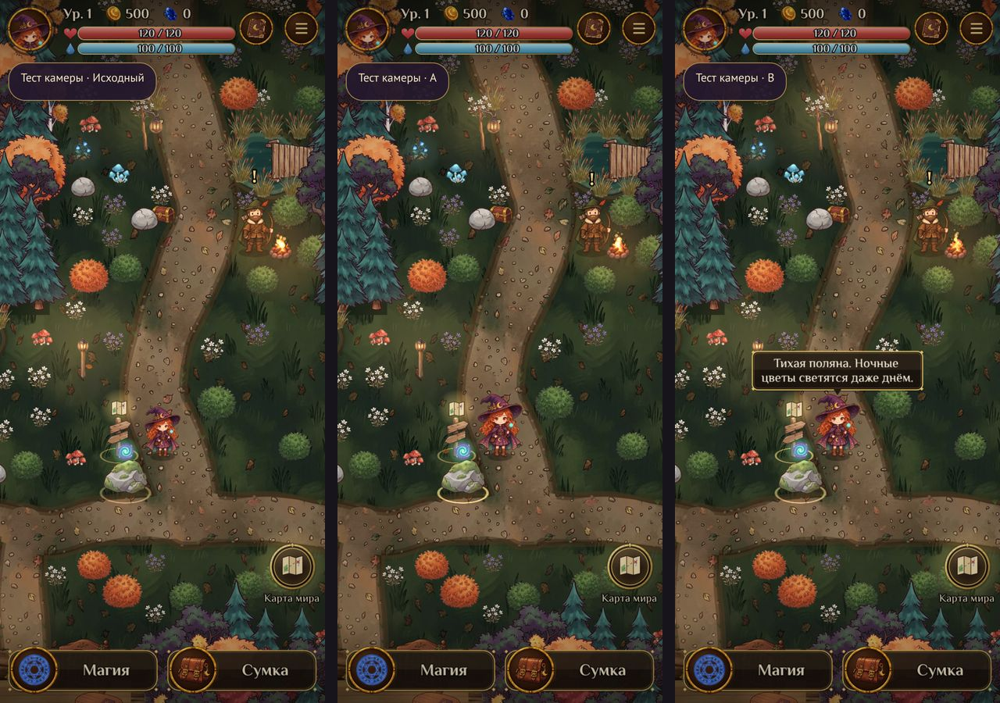
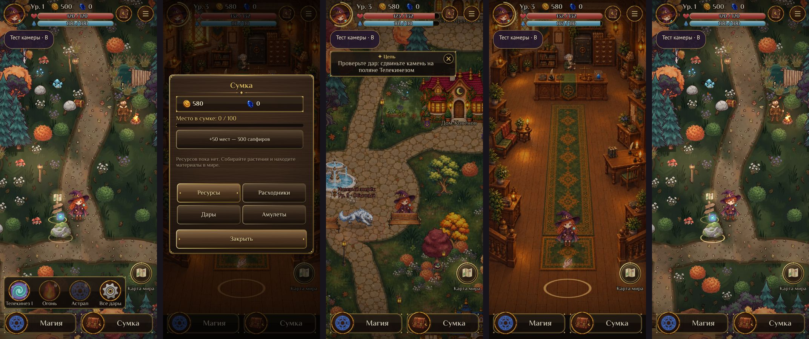
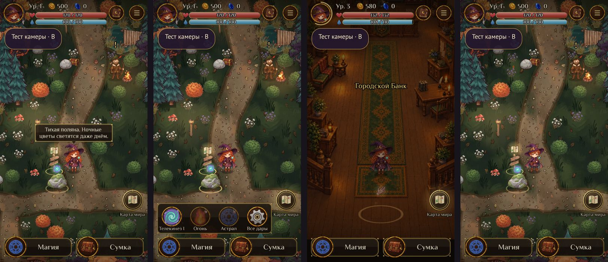

# Мобильный интерфейс приключения в /camera-test/ — 01.11.2026

Надстройка над экспериментом камеры (PR #131, `55d0ae8`). Боевая система, баланс, магия, сюжет, сохранения, авторизация, покупки и кошелёк не менялись. Основная игра визуально и по поведению та же: в `src/` вне `src/camera-test/` изменений нет.

## Как запустить

- Локально: `npm ci`, `npm run dev`, открыть выданный адрес с путём `/camera-test/`.
- Сборка: `npm run build`; страница лежит в `dist/camera-test/index.html`.
- Старый интерфейс для сравнения в той же сборке: `/camera-test/?hud=classic`. Переключатель есть и в панели «Тест камеры» (кнопки «Новый» / «Старый»).
- Адрес `https://grimuar.mobi/camera-test/` из контейнера проверить не удалось (запрос не был подтверждён), доступность нужно проверить вручную после публикации.

## Что сделано

**Верх (всегда на экране, высота 128 логических px).**
- Круглый портрет активного героя в утверждённой рамке `ui_craft_medallion`; золотая дуга вокруг него показывает опыт. Портрет — реальная голова текущей модели (ведьма или колдун) и обновляется при смене героя. Тап открывает профиль героя.
- Рядом уровень, золото и сапфиры с иконками. Значения берутся из `GameState`; большие числа сокращаются (123к, 1,2М).
- Две компактные полосы друг под другом: здоровье и мана (существующий `UIBar`).
- Справа круглые кнопки «Журнал» и «Меню», не закрывающие обзор. Журнал скрыт в бою.
- Таймер изучения дара появляется под полосами только пока идёт изучение.

**Низ.** Две кнопки в существующем деревянно-золотом стиле:
- «Магия» раскрывает над панелью лоток с настоящими способностями (те же кнопки, что в бою) и кнопкой «Все дары», которая открывает существующее окно даров.
- «Сумка» открывает настоящую сумку.
- Контекстная кнопка действия с объектами (сбор, разговор, вход) перенесена выше панели, работает как прежде.
- Лоток закрывается после применения дара, при открытии любого окна, при движении джойстика и при тапе по миру.

**Бой.** Ряд заклинаний стоит в прежних координатах и размере (`UI.dock`), после боя новый HUD возвращается.

**Камера.** Три режима (Исходный, A, B) не пересоздавались. Для расписных интерьеров без тёмных полос (например, банк) в эксперименте добавлен небольшой запас границ камеры, чтобы героиня на краю комнаты не оказывалась под верхним HUD или нижней панелью. Применяется только к новому HUD.

**Изоляция.** Облачные действия, аккаунт, кошелёк, чат, Ковены и дуэли по-прежнему отключены; хранилище с префиксом `witch_camera_test_v1:`.

## Результаты проверок

Всё выполнено в браузерной эмуляции (headless Chrome, `swiftshader`), физического телефона не было.

| Проверка | Результат |
|---|---|
| `npm test` | пройдено полностью |
| `npm run build` | пройдено, `dist/camera-test/index.html` создаётся |
| `npm run check:bundle` | пройдено |
| `npm run test:camera` | пройдено (+ геометрия HUD: границы, перекрытия, зоны касания, лоток, числа) |
| `npm run test:camera:browser` | пройдено на 320×568, 360×800, 390×844, 412×915, 720×1280 |

Браузерный тест проверяет в запущенной игре: значения золота, сапфиров, уровня, HP и маны берутся из состояния (и следуют за его изменением); элементы не перекрываются; зоны касания не меньше 44 CSS px на всех размерах; доля открытого мира; кнопка «Магия» открывает лоток; кнопка «Сумка» открывает окно; настоящий бой и возврат; отсутствие запросов к API и ошибок в консоли.

Дополнительно вручную прогнаны реальные касания: сбор травы, смена героя (портрет обновляется), джойстик и тап-движение, модальные окна.

Мир на вертикальном телефоне: при закрытом лотке HUD занимает около 128 px сверху и 128 px снизу, то есть открыто примерно 80–85% высоты (на старом HUD нижний ряд занимал заметно больше и закрывал обзор постоянно).

## Скриншоты реальной игры

Сравнение старого (слева) и нового (справа) HUD, лес, камера B:

Все размеры, новый HUD: 

Режимы камеры (Исходный, A, B) на 390×844: 

Лоток «Магия», сумка, город, интерьер банка и колдун на 390×844: 

Самый узкий телефон 320×568 (лес, лоток, интерьер, колдун): 

Остальные сравнения: [320×568](camera-test/hud/compare-320x568.jpg) · [360×800](camera-test/hud/compare-360x800.jpg) · [412×915](camera-test/hud/compare-412x915.jpg) · [720×1280](camera-test/hud/compare-720x1280.jpg)

## Ограничения

- Это не физический телефон: FPS в эмуляции 14–24 (программный рендер), реальная плавность, безопасные зоны экрана, системные жесты и экранная клавиатура не проверялись.
- На 320 px самые мелкие подписи HUD около 10–11 CSS px; подписи в лотке увеличены, но это самый тесный размер.
- Тестовые переходы «Город» и «Интерьер» выдают сюжетные награды (уведомления «+220 опыта…»): побочный эффект уже существующих кнопок эксперимента, не нового HUD.
- Расписные интерьеры без тёмных полос: на новом HUD запас камеры добавлен, на старом (`?hud=classic`) героиня на краю комнаты по-прежнему может оказаться под панелями.

## Вывод по камере

Для нового HUD лучше всего подходит **B** (+25% и мягкое опережение). Наблюдаемое опережение не превышало 65 логических px, ноги героини во всех трёх режимах остаются между верхним HUD и нижней панелью с запасом не менее 300 px, а в покое B выглядит так же, как A. A подходит, если опережение мешает; Исходный режим оставляет героиню мелкой на телефоне.
