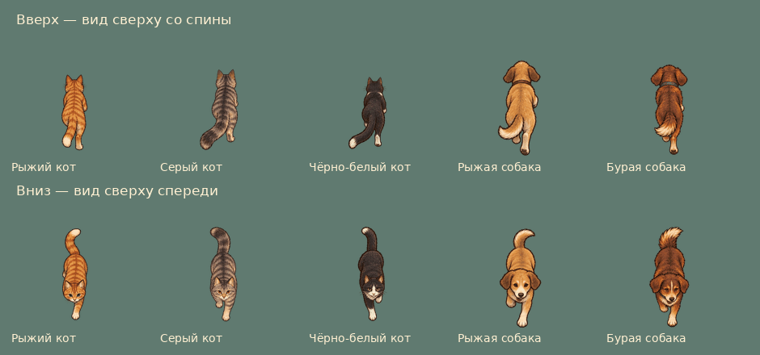

# Ракурсы животных и движение жителей

Коты и собаки при движении вверх используют отдельный рисунок сверху со спины, вниз — сверху спереди. Боковые рисунки остаются для горизонтального движения. Вращение животных отключено; на диагоналях ракурс выбирается с небольшим запасом, чтобы не мигать на границе.

Добавлены 50 прозрачных WebP: пять окрасов × два направления × пять поз (два шага, два кадра бега, сидит). Игровые файлы: `public/assets/city-life/painted-v2/`. Отображение: коты 48×64, собаки 56×72; исходные кадры в двойном разрешении. Прежние боковые изображения сохранены.

Истёкший срок жизни прохожего и сокращение населения больше не запускают растворение в кадре. Прохожий получает маршрут по связанным мощёным улицам за текущую камеру. Если путь пока недоступен, он продолжает гулять; удаление разрешено только когда весь рисунок уже за экраном с запасом. Конец короткого маршрута также не удаляет персонажа.

У гуляющих людей появилась небольшая физическая опора у ног, которая движется вместе с человеком и останавливает обоих главных героев. Эти движущиеся препятствия отделены от сетки постоянных стен. У спасённых жителей возле дома тоже есть опора; она включается вместе с появлением NPC, поэтому до спасения нет невидимых препятствий.

## Источники

Ракурсы нарисованы встроенным ImageGen по одному листу на каждый окрас, с прежними боковыми листами как референсом внешности и стиля. Полные промпты, имена оригиналов, SHA-256 и размеры: [`tools/art/city-life-directions-v2.sources.json`](../../tools/art/city-life-directions-v2.sources.json).

`python3 tools/art/prepare_city_life_directions.py /path/to/sources.json` извлекает десять полных фигур из каждого прозрачного листа, выравнивает масштаб и опору и кодирует WebP. Вход: `{ "cat_ginger": { "path": "/path/to/source.png", "prompt": "..." }, ... }`. Нужны Pillow, NumPy и SciPy. Сортировка рядов учитывает центр фигуры, чтобы высокий хвост нижнего ряда не попадал в верхний. Скрипт сохраняет оригинальную альфу и не дорисовывает позы.

## Проверки

- `npm test`: игровые данные, маршруты, выход по связанным улицам, ракурсы и наличие всех кадров.
- `node tests/e2e/city-life.mjs`: настоящий Phaser, декодирование 118 кадров, прогулка по городу, ракурсы без вращения, отсутствие удаления видимых людей, выход с короткой улицы, столкновения ведьмы и колдуна с четырёх сторон при ручном управлении и tap-to-move, очистка препятствий и видимость спасённых NPC.
- Проверка альфы, полных фигур и декодирования всех 50 новых WebP; просмотр исходников, подготовленных кадров и снимков игры.
- `npm run build`, `git diff --check`.

Browser plugin недоступен; проверка в браузере выполнена Playwright. Снимки находятся вне репозитория. Производительность на физическом телефоне отдельно не измерялась.
