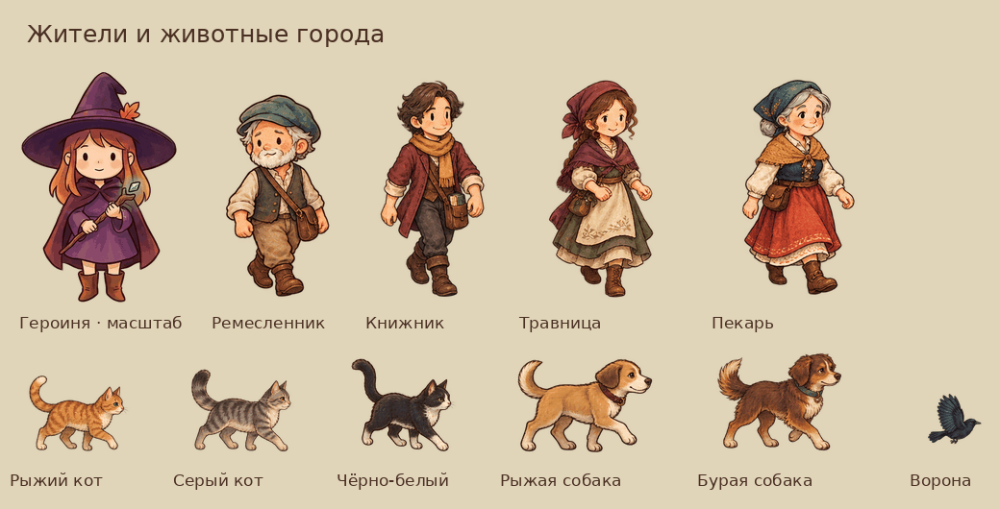

# Рисованные жители и животные города

Набор заменяет всю временную графику гуляющих горожан, котов, собак и ворон. Четыре горожанина различаются одеждой и силуэтом; животные получили нарисованную шерсть и анатомию, ворона — вытянутый силуэт, клюв и отдельную позу на крыше.

| Набор | Варианты | Кадры |
|---|---|---|
| Горожане | Ремесленник, книжник, травница, пекарь | 40: стойка и 4 шага спереди и со спины для каждого |
| Коты | Рыжий, серый полосатый, чёрно-белый | 15: 2 шага, 2 кадра бега и сидячая поза для каждого |
| Собаки | Рыжая, бурая | 10: 2 шага, 2 кадра бега и сидячая поза для каждой |
| Ворона | Угольно-чёрное оперение с холодными переливами | 3: крылья вверх, вниз и сложены |

Всего 68 прозрачных WebP. `public/assets/city-life/painted-v1/` — игровые файлы, `src/config/cityLife.painted.js` — привязки к прежним ключам. Размеры отображения сохранены: люди до 120 px по высоте, коты 80×54, собаки 96×60, вороны 40×34. Исходные игровые текстуры подготовлены в двойном разрешении. В превью герой и новые персонажи показаны в одном масштабе; места расположения на обзорном листе не являются расстановкой в городе.

Маршруты, количество существ, обход героини, плавное появление, повороты и настройка «Живой мир» используют прежнюю логику. Графика сюжетных NPC определяется отдельно от этого набора гуляющих жителей.

## Источники и подготовка

Использован встроенный ImageGen, по одному прозрачному листу на каждого из десяти персонажей/окрасов. Референсы: текущая героиня (`public/assets/sprites/hero_down.png`), нарисованные жители (`public/assets/chapter2/resident_man.webp`, `resident_woman.webp`) и настоящий кадр города (`docs/design/archive-courtyard/game-view.webp`). Арт-направление: тёплая рисованная фэнтезийная иллюстрация, тонкий тёмный контур, фактура ткани/шерсти и читаемый маленький силуэт.

Полные промпты, имена оригинальных PNG и SHA-256: [`tools/art/city-life-painted-v1.sources.json`](../../tools/art/city-life-painted-v1.sources.json). Оригинальные листы сохраняются ImageGen отдельно; игровые кадры находятся в репозитории.

`python3 tools/art/prepare_city_life_painted.py /path/to/sources.json` извлекает кадры из оригинальных листов. Требуются Python, Pillow, NumPy и SciPy. Вход: объект `{ "man_a": { "path": "/path/to/original.png", "prompt": "..." }, ... }` для всех вариантов из таблицы. Скрипт отделяет целые фигуры с их прозрачными краями, выравнивает масштаб и опору, уменьшает и кодирует WebP. Он не дорисовывает кадры, не перекрашивает и не деформирует части тела. Пустой или недекодируемый WebP останавливает подготовку.

## Проверки

- `npm test`: данные мира, маршруты, лимиты, анимационные ключи, UI и остальная игровая логика.
- `node tests/e2e/city-life.mjs`: настоящий Phaser; загрузка и декодирование всех 68 рисунков без запасных серых текстур; вид спереди/со спины, ходьба и бег зверей, перелёты, отсутствие толпы у героини, отключение/включение «Живого мира», отсутствие роста числа объектов.
- Прозрачность и декодирование всех WebP, ручной просмотр исходных листов и подготовленных кадров; полный размер и реальные кадры в городе.
- `npm run build` и `git diff --check`.

Browser plugin недоступен в этой сессии; визуальная проверка выполнена штатным Playwright-тестом проекта. Скриншоты и временные проверки сохраняются вне репозитория. Производительность на физическом телефоне отдельно не измерялась.
