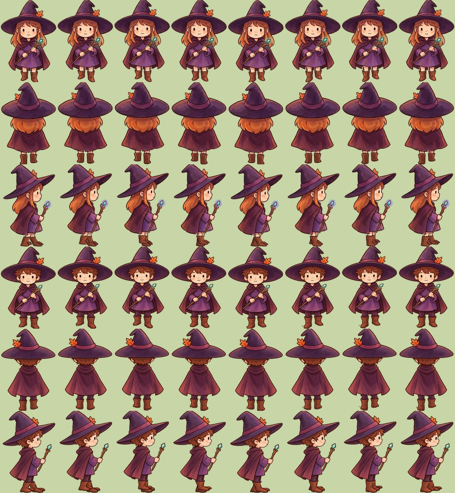

# Покадровая ходьба героев

Герои (ведьма и колдун) ходят по кадрам: 8 кадров на цикл из двух шагов, отдельно для видов спереди, сзади и сбоку.
Влево игра зеркалит вид сбоку.



## Откуда кадры

Сейчас кадры запечены из готовых рисунков (`hero_*.png`, `warlock_*.png`), нарисованных вручную их там нет.
Скрипт `tools/art/hero_walk_frames.py` вырезает ноги с сапогами, поднимает их по очереди и выносит вперёд-назад
(в профиле ноги качаются от бедра), приподнимает корпус на проходе и сдвигает плащ и шляпу с задержкой.
В профиле на рисунке сапоги перекрываются, задний виден узкой полоской, поэтому задняя нога достраивается как копия
передней, сдвинутая вправо и чуть темнее. Запуск из корня репозитория:

```
python3 tools/art/hero_walk_frames.py            # перезаписывает листы в public/assets/sprites
python3 tools/art/hero_walk_frames.py --preview  # и обновляет preview.jpg
```

Числа шага (подъём сапога, размах ног, приподнимание корпуса) лежат в начале скрипта, частота шага — `walkFrames.rate`
в `src/config/hero.anim.js` (сейчас 5 шагов в секунду). Линии разреза на ноги — в `HEROES`.
У ведьмы сапоги и кожа отличаются по цвету от плаща, поэтому берётся только их цвет. У колдуна штаны того же тона,
что плащ, поэтому ноги режутся по прямоугольнику ниже подола.

## Файлы

| Лист | Вид |
| --- | --- |
| `hero_walk_down.png`, `hero_walk_up.png`, `hero_walk_side.png` | ведьма |
| `warlock_walk_down.png`, `warlock_walk_up.png`, `warlock_walk_side.png` | колдун |

Каждый лист: ряд из 8 кадров 166×240 (1328×240 px), RGBA, ноги у нижнего края, как у стоячих рисунков.
Вид сбоку нарисован лицом вправо.

## Как заменить нарисованными кадрами

Положите файлы с теми же именами и тем же размером листа поверх запечённых. Код менять не нужно.
Если хотите другое число кадров, поменяйте `FRAMES` в скрипте и `WALK_FRAMES` в `src/config/hero.walk.js`,
размер листа должен быть `166 × число кадров` по ширине. Тест `tests/hero-test.mjs` проверяет имена и размеры.

Кадр выбирается по фазе шага (`HeroAnimator.cycle`), а не по таймеру: пока герой стоит у стены, шаги не идут.

## Как это подключено

- `src/config/hero.walk.js` — имена листов, число кадров, выбор кадра по фазе.
- `src/scenes/PreloadScene.js` — загружает листы как спрайт-листы.
- `src/objects/Player.js` — в ходьбе показывает кадр листа, стоя и при касте показывает обычный рисунок.
  Если лист не загрузился, герой ходит по-старому.
- `src/systems/HeroAnimator.js` — режим `frames: true` отключает процедурный подскок и покачивание (`walkFrames` в
  `src/config/hero.anim.js`), чтобы они не складывались с нарисованными в кадрах.

## Почему шаг всё равно немного скользит

Герой едет со скоростью 230 px/с при росте 120 px, а ноги у него короткие. Чтобы ступни стояли на земле, не скользя,
пришлось бы делать около 11 шагов в секунду, и это выглядело бы суетливо. Поэтому ноги размашистые и шаги частые (5 в секунду),
но небольшое скольжение остаётся. Чтобы убрать его совсем, нужно ехать медленнее (`PLAYER.speed` в `src/config/game.config.js`),
это уже влияет на темп игры.
